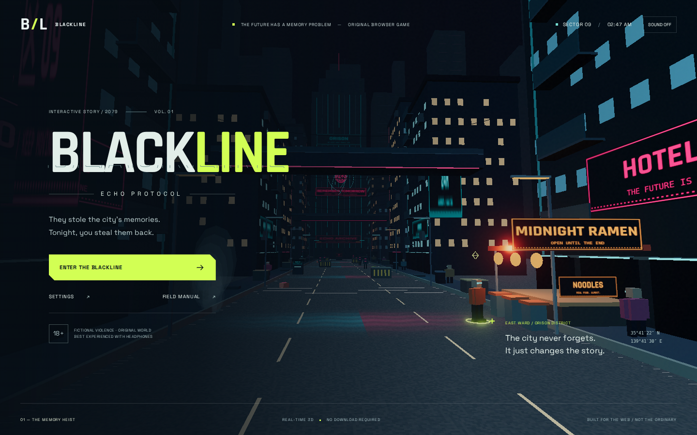
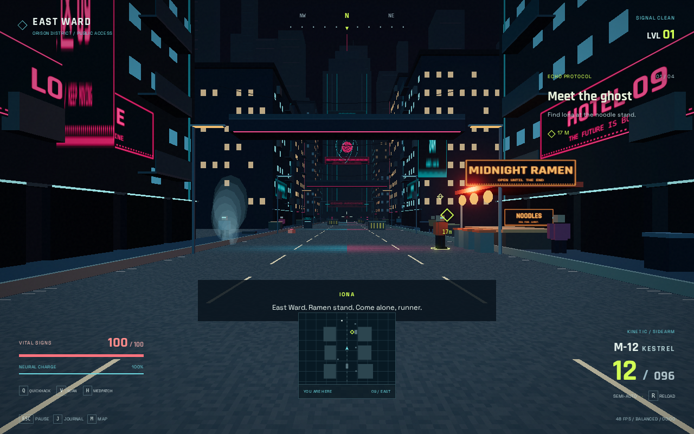
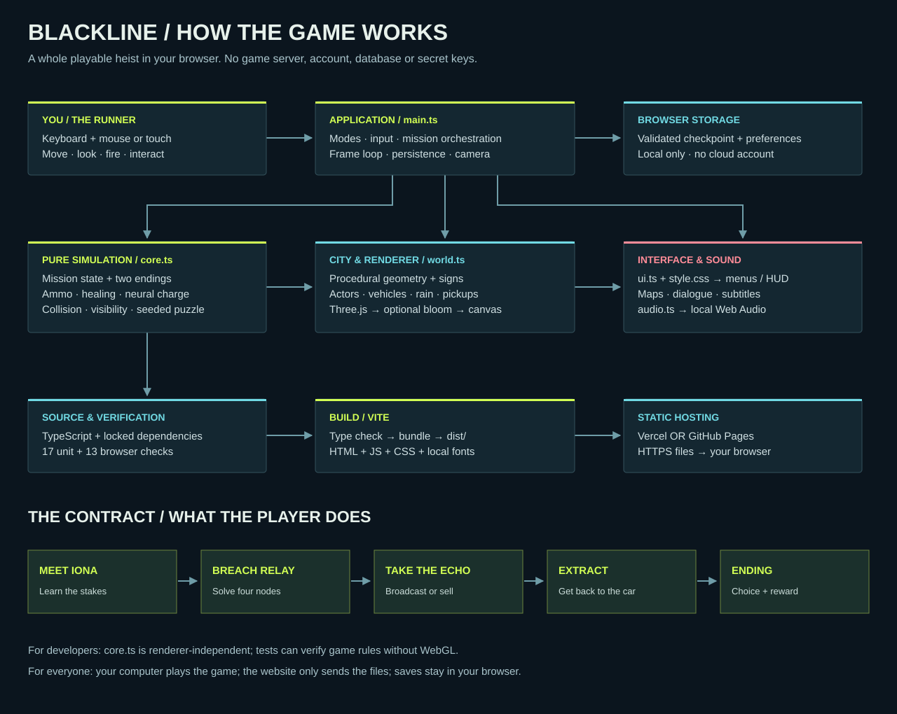

# BLACKLINE / Echo Protocol

**An original, playable cyberpunk first-person browser heist.**

[Play the browser build](https://devilking08.github.io/blackline-echo-protocol/) · [Deploy to Vercel](https://vercel.com/new/clone?repository-url=https%3A%2F%2Fgithub.com%2Fdevilking08%2Fblackline-echo-protocol) · [Architecture](docs/ARCHITECTURE.md) · [Verification](docs/VERIFICATION.md)



## The contract

Orison repossesses memories and rents them back to the people it took them from. A fixer named Iona has located the ledger. Meet her at Midnight Ramen, breach a surveillance relay, reach the Echo archive, and decide whether the truth belongs to the city or the highest bidder. Then make it back to the extraction vehicle.

This is a compact, single-player **vertical slice**, not a reproduction of Cyberpunk 2077 or a full AAA open-world RPG. The city, characters, dialogue, geometry, procedural textures, and sound synthesis are original. No CD PROJEKT RED assets, characters, maps, music, or story content are distributed. No claim of AAA parity, universal frame rates, or superiority to other games is made.

## Play now

Open the [hosted build](https://devilking08.github.io/blackline-echo-protocol/), click **Enter the Blackline**, and follow the lime diamond. Use current Chrome, Edge, Firefox, or Safari with WebGL2 enabled. Desktop with mouse and keyboard is recommended; touch controls are included.

### Local development

Requires Node **22.12+** and npm.

```sh
git clone https://github.com/devilking08/blackline-echo-protocol.git
cd blackline-echo-protocol
npm ci
npm run dev
```

For a production build:

```sh
npm run build
npm run preview
```

Open the URL printed by Vite. Do not double-click `index.html`: ES modules and fonts require an HTTP server.

## What is implemented

- A walkable, procedurally constructed 3D district with sidewalks, building facades, illuminated signs, skybridges, an archive tower, a ramen stand, cables, supply caches, pedestrians, flying traffic, steam geometry, and animated holographic rings.
- Original mission progression: **contact → relay → archive → escape → complete**, with two authored endings.
- First-person movement, sprint, crouch, jump, mouse-look, aim zoom, and touch move/look controls.
- Raycast sidearm combat, headshots, ammunition accounting, reloads, weapon recoil, hit feedback, seven security units, visibility-aware detection, chase, cover checks, and stun states.
- Scanner, quickhack, regenerating neural energy, medpatches, and ammunition/health pickups.
- A solvable relay breach puzzle with a wrong-input buffer reset.
- Live HUD, objective diamond, compass, minimap, district map, journal, subtitle dialogue, pause menu, and result screen.
- Versioned, validated local checkpoint saves and preferences; graceful handling of corrupt or blocked storage.
- Three render profiles, capped device pixel ratio, optional bloom, low-profile adaptive resolution, reduced-motion mode, and a reduced-damage story-assist setting.
- Local Web Audio synthesis: sidearm, hit, damage, interface, hack and completion cues, plus an ambient drone.
- Static deployment, no runtime API, no account, no analytics, no external asset requests after deployment, no credentials.



## Controls

| Control           | Action                                           |
| ----------------- | ------------------------------------------------ |
| WASD / arrow keys | Move                                             |
| Mouse             | Look; click captures pointer                     |
| Left click / F    | Fire                                             |
| Right click       | Aim                                              |
| R                 | Reload                                           |
| Shift             | Sprint                                           |
| Space             | Jump                                             |
| C, held           | Crouch and reduce detection range                |
| E                 | Talk, breach, access archive, extract            |
| Q                 | Stun targeted visible guard; 35 neural charge    |
| V                 | Toggle scanner                                   |
| H                 | Heal up to 40 vitality; 25 neural charge         |
| J / M             | Journal / map                                    |
| Esc               | Pause, release pointer, or close a utility panel |
| F2                | Hide/show HUD for screenshots                    |

If pointer lock is unavailable, hold the left mouse button to look and use **F** to fire. On touch devices, use the left pad to move, drag the right part of the scene to look, and use the action buttons. The touch layout does not expose every desktop shortcut.

### Mission hints

1. Iona is at the ramen stand on the right, about 17 m from spawn.
2. Relay 07 is on the west side. Enter the four displayed hexadecimal nodes in order.
3. The archive console is at the north end, before the Orison tower. Security can be fought, stunned, or avoided. Supplies are on the sidewalks.
4. Choose broadcast or sale, then return south to the extraction vehicle. Press E near its front.

### Saving

Mission transitions, save-and-quit, and page exit write a checkpoint to `blackline.save.v1`. Preferences use `blackline.settings.v1`. These are local to this browser and origin. On continue, security units and supplies reset; their transient state is not serialized. Death leaves the last living checkpoint intact. Completion clears the active save. Browser storage is optional: the game still runs when it is blocked, but progress cannot persist.

## Deploy to Vercel

Import this repository and select **Vite**. The committed `vercel.json` provides:

| Setting                     | Value                                   |
| --------------------------- | --------------------------------------- |
| Install                     | `npm ci` (Vercel default with lockfile) |
| Build                       | `npm run build`                         |
| Output                      | `dist`                                  |
| Environment variables       | **None**                                |
| Server functions / database | **None**                                |

The deploy button above starts Vercel's repository import flow. A Vercel account authorization is still required; this delivery does not claim a deployment into your Vercel account. An independent GitHub Pages build is hosted separately.

## Test and maintain

```sh
npm run check                     # 17 core tests + strict TypeScript + Vite build
npx playwright install --with-deps chromium
npm run test:e2e                  # 13 production browser checks
npm run format:check              # source formatting
npm audit --omit=dev
```

Browser tests run Chromium with SwiftShader to verify functionality without relying on a dedicated GPU in CI. This is **not** proof of smooth performance on every CPU-only device. The `window.blackline.snapshot()` diagnostic API is read-only and reports scene/game state for QA. It is not a multiplayer security boundary.

## System map



See [architecture and design decisions](docs/ARCHITECTURE.md), [security](docs/SECURITY.md), [references and skills](docs/RESEARCH.md), and [verification evidence](docs/VERIFICATION.md).

## Honest limits

This release contains one authored street-level mission. It does not include vehicle driving, enterable building interiors, a large branching campaign, multiplayer, motion capture, voice acting, physically simulated reflections, ray tracing, destructible environments, or a full RPG progression system. Visuals intentionally use procedural low-poly geometry. Wet-road highlights are stylized shader effects, not true reflections. AI uses simple line-of-sight/chase logic, not navmesh routing; obstacles can trap a pursuing unit. Jump is a camera-height action, not a full 3D platform/step solver. Software-only graphics may run slowly. Prefer Low profile on constrained hardware.

## License

Original application code: MIT. Three.js: MIT. Bundled Rajdhani and Space Grotesk fonts: SIL Open Font License, with their license texts in `public/fonts`. See [third-party notices](THIRD_PARTY_NOTICES.md). Research references are not bundled game assets.
